# TraceForge

Research-prototype workbench over real Dental-Agent artifacts (agent traces,
zero-shot evals, YOLO pre-labels, annotations). **Research prototype, not for
clinical use.**

Plan status: M0–M4 done, M5 in progress. Decisions: `docs/adr/` (ADR-0001 through ADR-0023).

## Live demo

**https://dentalforge-app.vercel.app** — Next.js app on Vercel, Postgres on
Supabase. Start at [`/status`](https://dentalforge-app.vercel.app/status) to
see the capability ladder (database, worker mode, Redis, storage), then browse
traces, evals, labels, quality, and rewards. Public artifacts are DENTEX-derived
only; the Tufts data never leaves local development. Research prototype, not for
clinical use — the demo database is reset periodically.

## Screenshots

| Page | Light | Dark | Mobile |
|------|-------|------|--------|
| Landing | 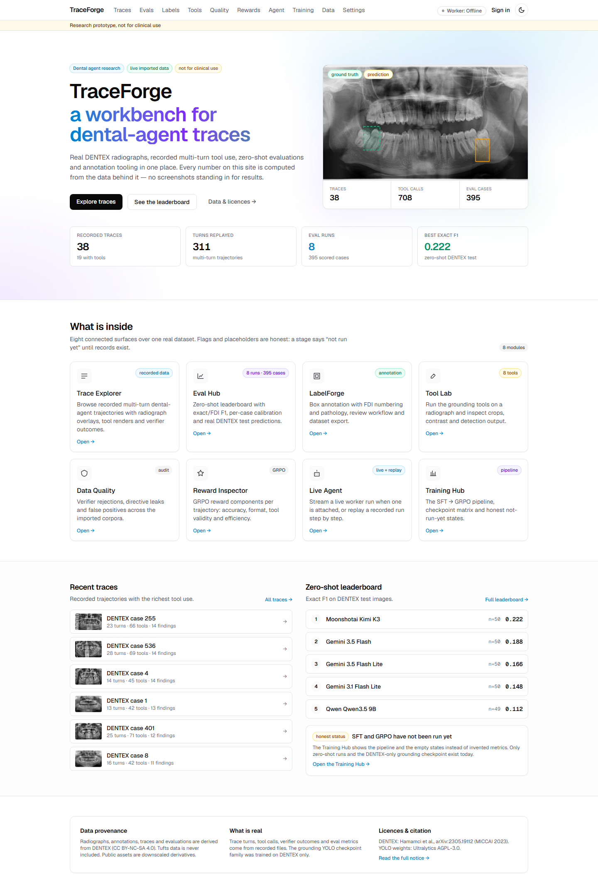 | 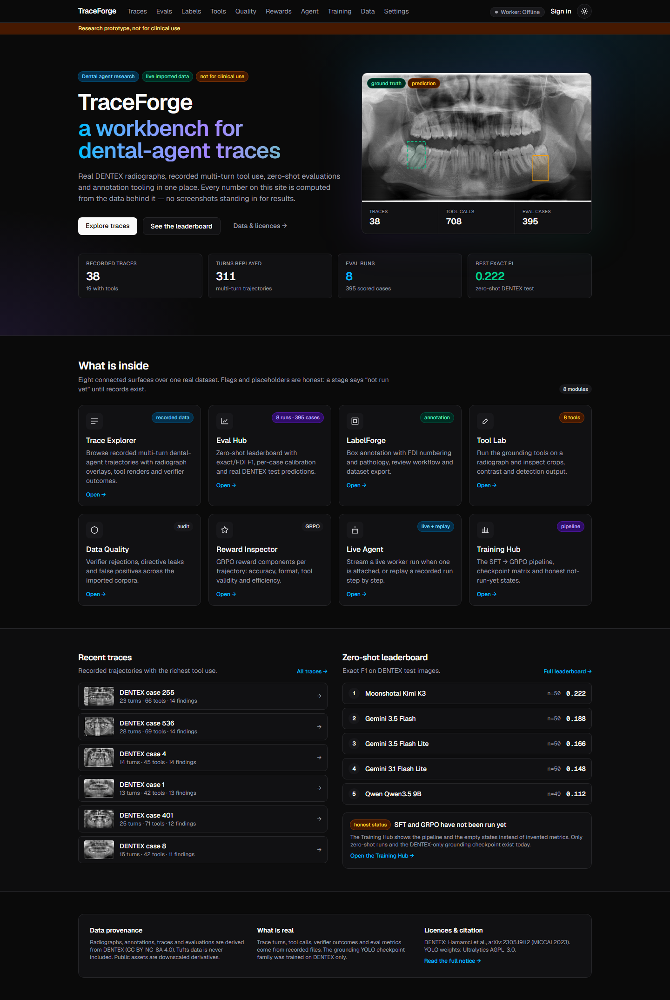 | — |
| Trace Explorer | 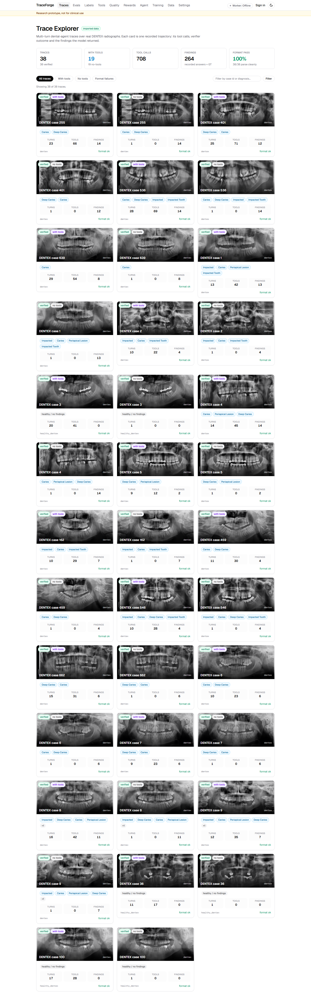 | — | 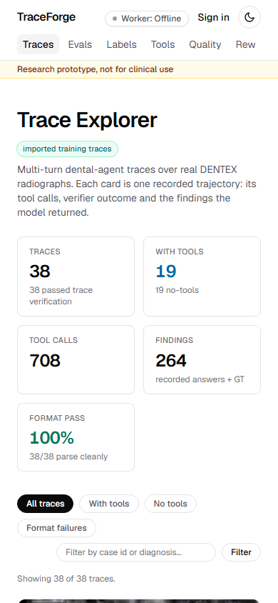 |
| Trace Detail (case 255) | 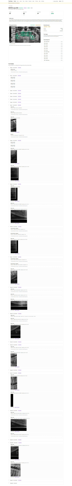 | 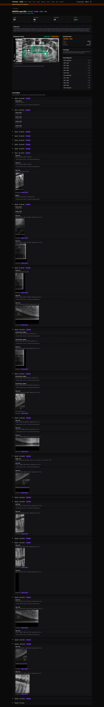 | 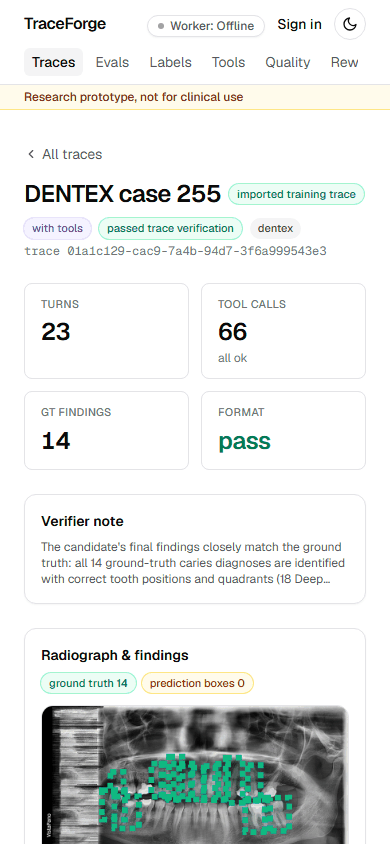 |
| Eval Hub | 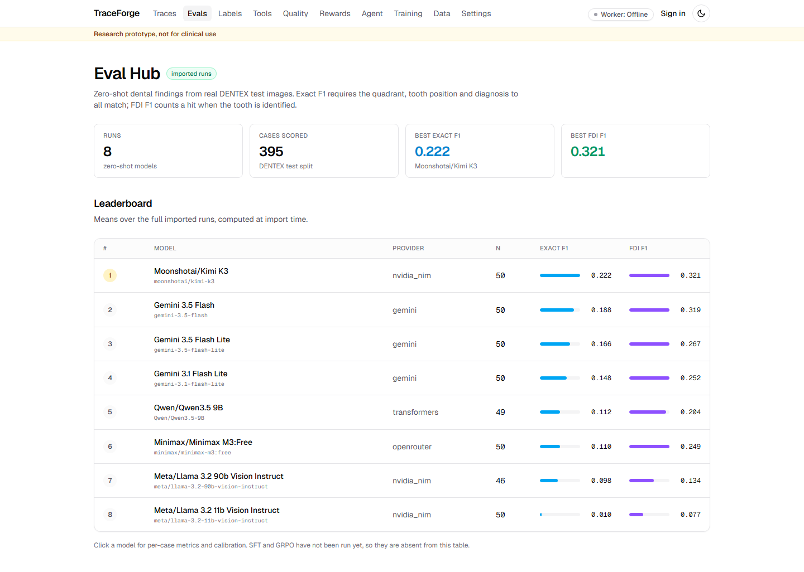 | — | — |
| Eval Detail | 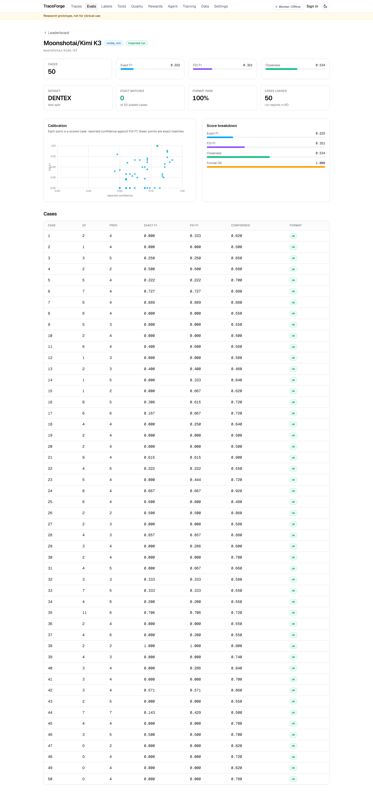 | — | — |
| Live Agent (replay) | 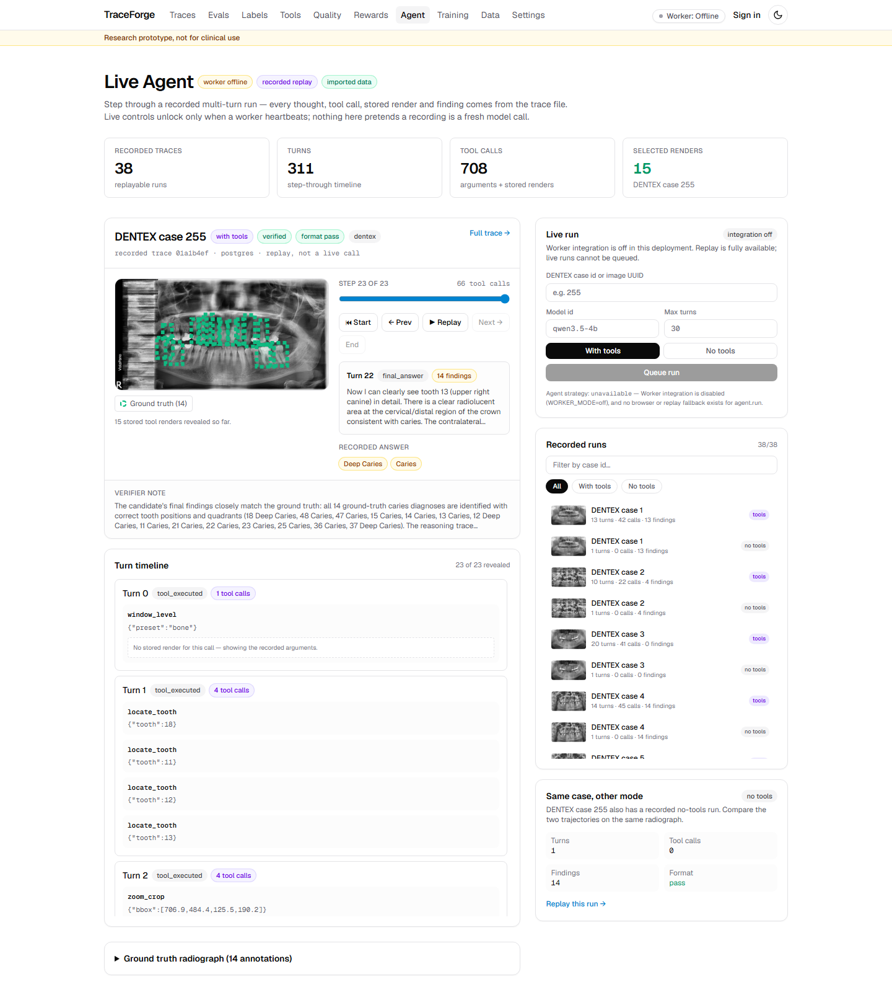 | 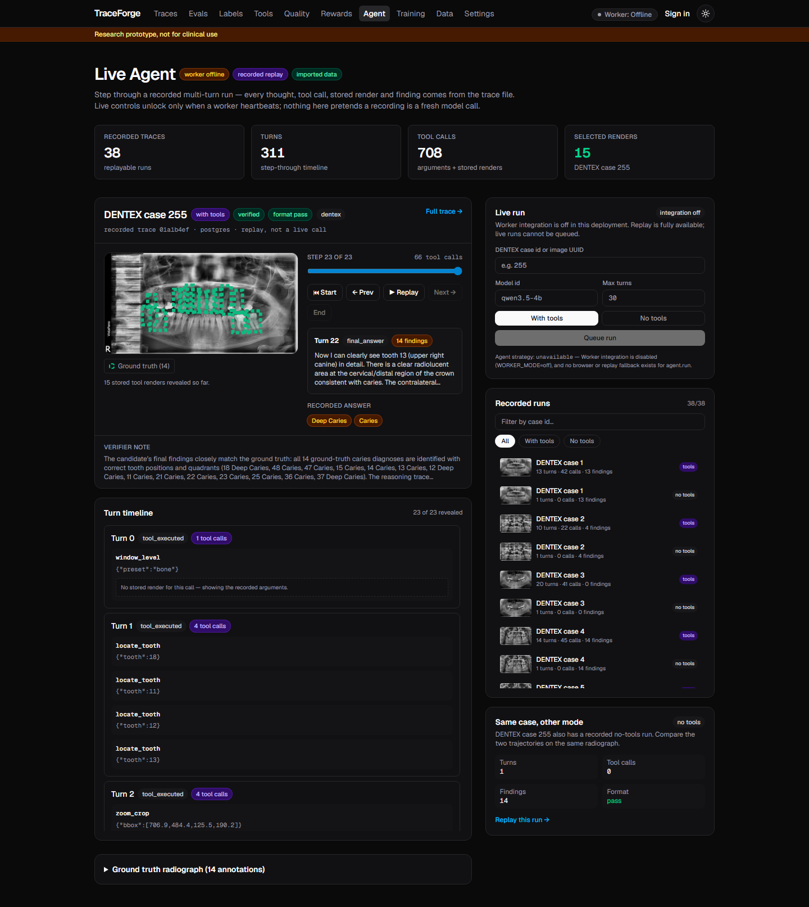 | 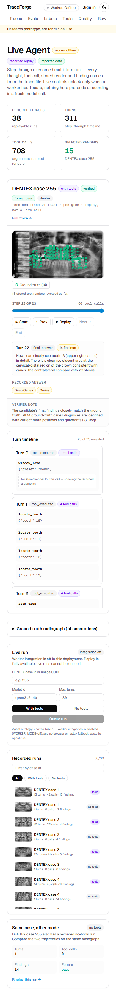 |
| Training Hub | 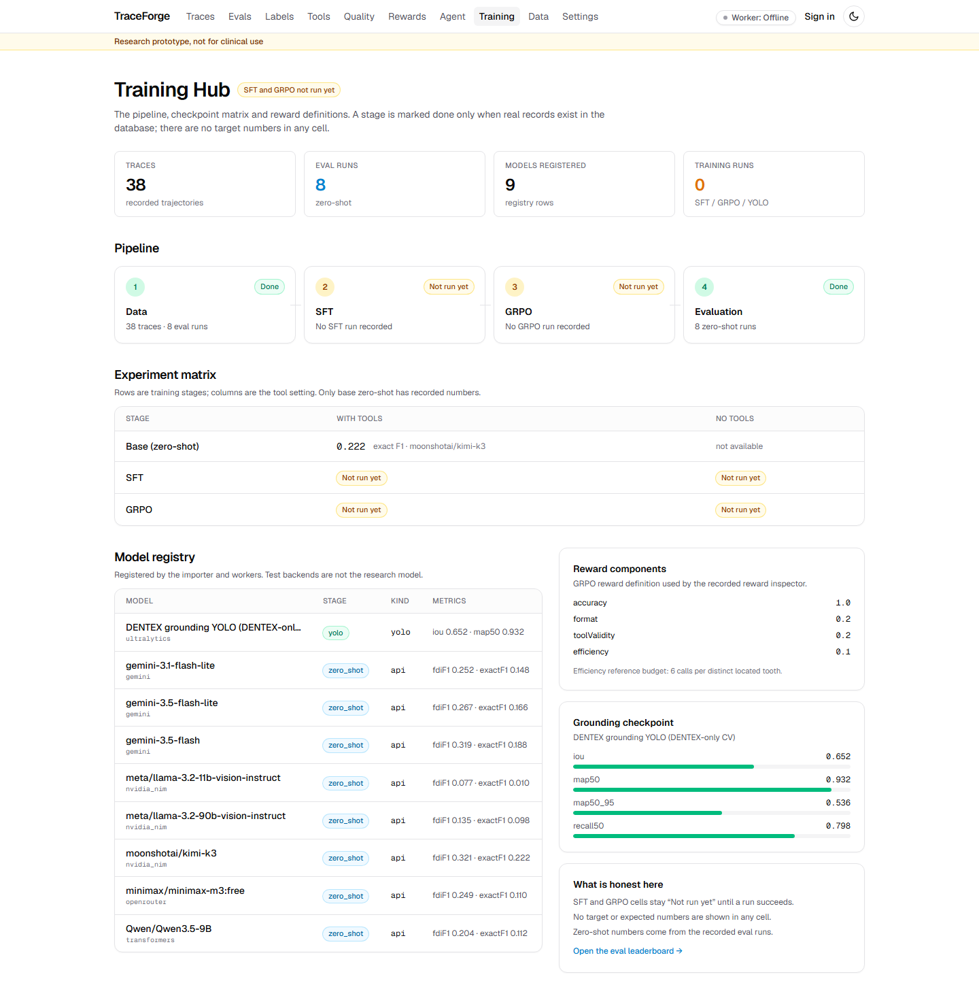 | — | — |
| Data & Licences | 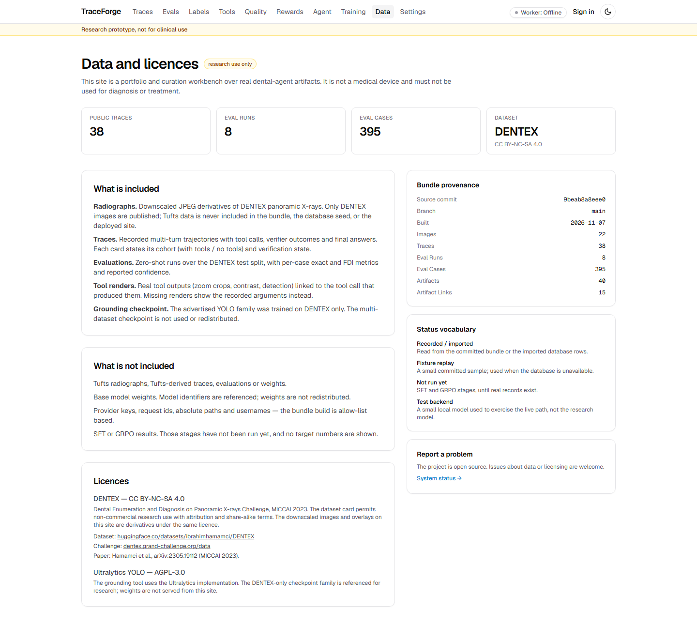 | — | — |

All screenshots are captured by Playwright against the production build with
strict console error and horizontal overflow checks (`scripts/capture-screenshots.mjs`).

## Architecture

```
┌─────────────────────────────────────────────────────────────────┐
│                        Next.js App (Vercel)                     │
│  ┌─────────────┐  ┌─────────────┐  ┌─────────────┐             │
│  │  /traces    │  │  /evals     │  │  /agent     │  ...        │
│  └──────┬──────┘  └──────┬──────┘  └──────┬──────┘             │
│         │                │                │                     │
│         └────────────────┼────────────────┘                     │
│                          ▼                                     │
│              ┌─────────────────────┐                           │
│              │   DataSource        │                           │
│              │  (fixture / postgres)                            │
│              └──────────┬──────────┘                           │
└─────────────────────────┼──────────────────────────────────────┘
                          │
         ┌────────────────┼────────────────┐
         ▼                ▼                ▼
┌────────────────┐ ┌────────────┐ ┌────────────────┐
│  Supabase      │ │  Local     │ │  R2 / Blob     │
│  Postgres      │ │  fs        │ │  (when creds)  │
└────────────────┘ └────────────┘ └────────────────┘
```

### Run modes

| Mode | `TRACEFORGE_DATASOURCE` | `WORKER_MODE` | Data | Live runs |
|------|------------------------|---------------|------|-----------|
| Demo (production) | `postgres` | `off` | Seeded DENTEX from bundle | ❌ Replay only |
| Local dev (fixture) | *(unset)* | `off` | Fixtures in `fixtures/` | ❌ Replay only |
| Local dev (postgres) | `postgres` | `off` | Local DB | ❌ Replay only |
| Live session | `postgres` | `live` | Your org | ✅ Queued jobs |

The capability ladder at `/status` reflects the active mode in real time.

### Data and licences

| Asset | Public? | Licence / note |
|-------|---------|----------------|
| DENTEX images (downscaled) | Yes | CC BY-NC-SA 4.0 — attribution, non-commercial, share-alike |
| DENTEX ground truth annotations | Yes | Same licence |
| Traces on DENTEX (model outputs, tool renders) | Yes, sanitized | Derived from DENTEX; provider terms must allow publishing |
| Zero-shot eval runs (8 tracked) | Yes | Already public in VLM-DENTAL; sanitized |
| Tufts images, traces, evals, weights | **Never** | Terms unverified; guarded by build (fails on `tufts` markers) |
| YOLO DENTEX-only weights (ONNX) | Yes | AGPL-3.0 (Ultralytics); DENTEX-only training verified in WP0 |
| Multi-dataset YOLO weights | No | Until Tufts terms confirmed |
| Base model weights (Qwen, Llama, etc.) | No | Reference model ids only |
| Secrets, tokens, absolute paths, usernames | Never | Canary test + secret scan in CI |

The `/about-data` page shows the full notice with citations.

## Quickstart

```bash
pnpm install
pnpm dev        # http://localhost:3000 (fixture mode)
```

To run against a local Postgres with the demo data:

```bash
# 1. Start Postgres (e.g. Supabase local or Docker)
# 2. Set DATABASE_URL in .env.local
# 3. Build the demo bundle and seed
pnpm demo:build
pnpm demo:seed --reset
# 4. Run with postgres data source
TRACEFORGE_DATASOURCE=postgres pnpm dev
```

## Quality gates (also run in CI)

```bash
pnpm typecheck   # tsc --noEmit
pnpm lint        # eslint
pnpm test        # vitest run
pnpm ci          # all three
pnpm build       # production build (self-hosted Geist, no Google Fonts fetch)
```

## Browser tests (Playwright + axe)

Against the **production build** (`pnpm build` first). Each spec boots its own
`next start` with an explicit environment matrix (DB down, worker off, Redis
unreachable, failing storage).

```bash
pnpm exec playwright install chromium   # once
pnpm build
pnpm e2e:browser                        # Postgres on localhost:5433 (or E2E_DATABASE_URL)
```

They cover: every page under five degraded shapes, the worker-token UI (create →
shown once → copy → revoke), hydration with existing local state, and an axe
WCAG A/AA pass in light and dark. Where Playwright's browser download is
blocked, set `PW_CHROMIUM_PATH` to any Chromium binary (and `PW_CHROMIUM_ARGS`,
e.g. `--no-sandbox`, inside a container).

## Worker tests

```bash
pnpm e2e:worker                         # contract + handler tests with real worker
```

## Learn More (TraceForge docs)

- [`VLM_INTEGRATION_IMPLEMENTATION_PLAN.md`](./VLM_INTEGRATION_IMPLEMENTATION_PLAN.md) — work packages WP0–WP12
- [`docs/adr/`](./docs/adr/) — ADR-0001 through ADR-0023 (schemas, parity, leak-definition fix, worker contract, ingest, etc.)
- Data honesty: directive leak = assistant text matching VLM-DENTAL `LEAK_PATTERNS` (**0 / 5,454**); teacher scaffold in stored user messages is expected setup (5,454 / 5,454) — see ADR-0006.

## Deploy on Vercel

Production: **https://dentalforge-app.vercel.app** (Vercel project
`dentalforge-app`), backed by a Supabase Postgres database. Required production
env: `DATABASE_URL` (Supabase pooler), `BETTER_AUTH_URL`, `BETTER_AUTH_SECRET`,
`INVITE_SIGNING_SECRET`, `TRACEFORGE_DATASOURCE=postgres`, `WORKER_MODE=live`.
Secrets must be unique — the app refuses to boot with the public dev/example
values (see `src/shared/config/env.ts`). See [`docs/supabase.md`](./docs/supabase.md)
for the database runbook.

Standard Next.js deploy. Builds are self-hosted (Geist via the `geist`
package, no Google Fonts fetch). `WORKER_MODE` defaults to `off`; never set
`HF_TOKEN` on Vercel (local import scripts only). Storage is currently the
ephemeral local adapter, so uploads do not persist across deploys — configure R2
before relying on uploads.